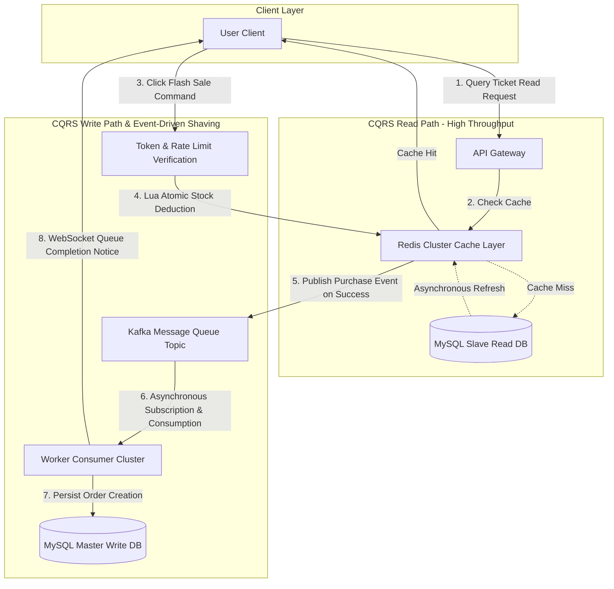

# Software Requirements Specification

## For Online Ticket Flash Sale System

Version 1.0  
Prepared by TangtangYang  
University of Debrecen  
2026-10-26

## Table of Contents

<!-- TOC -->

- [1. Introduction](#1-introduction)
  - [1.1 Purpose](#11-purpose)
  - [1.2 Document Conventions](#12-document-conventions)
  - [1.3 Intended Audience and Reading Suggestions](#13-intended-audience-and-reading-suggestions)
  - [1.4 Product Scope](#14-product-scope)
  - [1.5 References](#15-references)
- [2. Overall Description](#2-overall-description)
  - [2.1 Product Perspective](#21-product-perspective)
  - [2.2 Product Functions](#22-product-functions)
  - [2.3 User Classes and Characteristics](#23-user-classes-and-characteristics)
  - [2.4 Operating Environment](#24-operating-environment)
  - [2.5 Design and Implementation Constraints](#25-design-and-implementation-constraints)
  - [2.6 User Documentation](#26-user-documentation)
  - [2.7 Assumptions and Dependencies](#27-assumptions-and-dependencies)
- [3. External Interface Requirements](#3-external-interface-requirements)
  - [3.1 User Interfaces](#31-user-interfaces)
  - [3.2 Hardware Interfaces](#32-hardware-interfaces)
  - [3.3 Software Interfaces](#33-software-interfaces)
  - [3.4 Communications Interfaces](#34-communications-interfaces)
- [4. System Features](#4-system-features)
  - [4.1 System Feature 1](#41-system-feature-1)
  - [4.2 System Feature 2 (and so on)](#42-system-feature-2-and-so-on)
- [5. Other Nonfunctional Requirements](#5-other-nonfunctional-requirements)
  - [5.1 Performance Requirements](#51-performance-requirements)
  - [5.2 Safety Requirements](#52-safety-requirements)
  - [5.3 Security Requirements](#53-security-requirements)
  - [5.4 Software Quality Attributes](#54-software-quality-attributes)
  - [5.5 Business Rules](#55-business-rules)
- [6. Other Requirements](#6-other-requirements)
- [Appendix A: Glossary](#appendix-a-glossary)
- [Appendix B: Analysis Models](#appendix-b-analysis-models)
- [Appendix C: To Be Determined List](#appendix-c-to-be-determined-list)
<!-- TOC -->

## Revision History

| Name    | Date       | Reason For Changes                               | Version |
| ------- | ---------- | ------------------------------------------------ | ------- |
| Student | 2026-10-26 | Initial English draft based on IEEE 830 standard | 0.1     |

## 1. Introduction

### 1.1 Purpose

This Software Requirements Specification (SRS) document provides a comprehensive and rigorous description of the requirements for the Online Ticket Flash Sale System. Based on the IEEE Standard 830 format, this document outlines the architectural constraints (Event-Driven Architecture and CQRS pattern), functional requirements, and non-functional quality attributes to guide software architects, developers, testers, and academic evaluators.

### 1.2 Document Conventions

- Standard Markdown formatting is applied throughout the document.
- Functional requirements are uniquely identified using the format `FR-<Category>.<ID>`.
- Non-functional requirements are identified using the format `NFR-<Category>.<ID>`.
- Architectural markers such as **[EDA]** denote asynchronous event-driven paths, and **[CQRS]** denote Command Query Responsibility Segregation paths.

### 1.3 Intended Audience and Reading Suggestions

- **Software Architects**: Focus on Section 2 (Overall Description) and Section 5 (Nonfunctional Requirements) to validate the EDA + CQRS architectural pattern selection.
- **Developers**: Refer to Section 3 (External Interfaces) and Section 4 (System Features) for module design and coding implementation.
- **QA and Test Engineers**: Utilize Section 4 and Section 5 for high-concurrency performance test cases and verification metrics.
- **Academic Evaluators**: Review Section 1 for project scope and Section 4 for core domain logic.

### 1.4 Product Scope

The Online Ticket Flash Sale System is designed to handle extreme burst traffic (e.g., hot concerts, major sports events). Its primary objective is to guarantee system availability, absolute zero over-selling, and low-latency response under massive concurrency.

- **In-Scope**:
  - User authentication and dynamic token generation.
  - High-throughput ticket inventory queries via CQRS read-side caching.
  - Asynchronous flash sale order placement and traffic peak-shaving via EDA messaging.
  - Order lifecycle management, payment integration, and automatic stock release for unpaid orders.
- **Out-of-Scope**:
  - Physical hardware ticket printer integration.
  - Implementation of third-party banking payment gateways (standard API integration only).

### 1.5 References

1. IEEE Std 830-1998, _IEEE Recommended Practice for Software Requirements Specifications_.
2. Architecture Decision Records (ADR) Standard Repository format: https://github.com/architecture-decision-record/architecture-decision-record
3. Martin Fowler, _Event-Driven Architecture_, https://martinfowler.com/articles/201701-event-driven.html
4. Martin Fowler, _CQRS Pattern_, https://martinfowler.com/bliki/CQRS.html

---

## 2. Overall Description

### 2.1 Product Perspective

The system is a greenfield distributed application built to replace traditional monolithic synchronous architectures that fail under flash-sale traffic spikes. It adopts an **Event-Driven Architecture (EDA)** as its primary paradigm, coupled with **Command Query Responsibility Segregation (CQRS)**:

- **Read Path**: User ticket browsing and inventory checks are served directly by edge CDN and Redis cache clusters, bypassing the primary database to ensure extreme throughput and low latency.
- **Write Path**: Ticket purchase commands are published as `TicketPurchaseEvent` messages into a high-throughput message queue (Apache Kafka), where asynchronous worker threads process orders and persist data safely.

### 2.2 Product Functions

1. **User Authentication & Dynamic Token Distribution**: Expose temporary secure URLs and tokens prior to the flash sale to mitigate bot attacks.
2. **Real-time Inventory Inquiry [CQRS Read]**: Sharded and pre-warmed cache reads for concurrent availability checks.
3. **Atomic Flash Sale Deduction [CQRS Write / EDA Producer]**: Concurrency-safe stock pre-deduction using Redis Lua scripts.
4. **Asynchronous Peak Shaving [EDA Event Queue]**: Instantly push purchase events to message queues and return queue status to clients.
5. **Asynchronous Order Persistence [EDA Consumer]**: Background workers consume events, validate consistency, and persist orders.
6. **Automatic Timeout Release**: Delay queues automatically return un-paid stock back to inventory after 15 minutes.

### 2.3 User Characteristics

1. **General End-Users**: Representing over 99% of traffic, accessing the system simultaneously at flash-sale launch with strict expectations for low response latency.
2. **System Administrators**: Responsible for event configuration, inventory pre-heating, and monitoring system parameters.
3. **DevOps Engineers**: Monitor message queue backlog, cache hit rates, and database CPU loads.

### 2.4 Operating Environment

- **Operating System**: Linux (Ubuntu Server 22.04 LTS / RHEL 9)
- **Containerization & Orchestration**: Docker, Kubernetes (k8s)
- **Caching Layer**: Redis 7.x Cluster (Primary-Replica & Sharded)
- **Messaging Middleware**: Apache Kafka 3.x
- **Persistence Database**: MySQL 8.0 (Primary-Secondary replication with read/write splitting)
- **Network Environment**: HTTP/2, WebSocket, CDN edge nodes

### 2.5 Design and Implementation Constraints

1. **Architectural Constraint**: Must strictly adhere to the EDA + CQRS decoupling pattern, prohibiting synchronous blocking calls on write paths.
2. **Data Consistency Constraint**: Write paths follow eventual consistency while maintaining absolute zero over-selling.
3. **Security Constraint**: Must incorporate rate limiting, CAPTCHA, and dynamic URL tokens to defend against script scalpers.

### 2.6 User Documentation

1. _System Integration and API Specification Manual_
2. _Flash Sale Event Configuration and Pre-heating Guide_
3. _High-Concurrency Emergency Incident Response and Queue Backlog Troubleshooting Handbook_

### 2.7 Assumptions and Dependencies

1. Assumes client network stability and that CDN nodes successfully intercept over 80% of static asset traffic.
2. Relies on the reliability and high availability of third-party payment gateway webhooks.

---

## 3. External Interface Requirements

### 3.1 User Interfaces

1. **Pre-sale Waiting Interface**: Features a countdown timer with the purchase button disabled until sale ignition.
2. **Queue Processing Interface**: Displays animated WebSocket/polling status updates reading "Queueing in progress".
3. **Order Payment Interface**: Displays an order payment countdown (15 minutes) and payment QR code.

### 3.2 Hardware Interfaces

The system is a pure software distributed architecture with no dedicated hardware interface requirements, running on standard x86_64 or ARM64 cloud infrastructure.

### 3.3 Software Interfaces

1. **Redis API**: Executing Lua scripts for atomic in-memory stock management and cache queries.
2. **Kafka Produce/Consume API**: Publishing and subscribing to `TicketPurchaseEvent` streams.
3. **Third-Party Payment API**: RESTful over HTTPS for payment status transactions.

### 3.4 Communications Interfaces

1. Client-Server Communication: Mandatory HTTPS with TLS 1.3 encryption.
2. Real-time Notifications: WebSocket full-duplex persistent connections for queue results.
3. Internal Inter-service Communication: gRPC/TCP protocols for high-performance serialization.

---

## 4. System Features

### 4.1 System Feature 1

**System Feature 1: User Authentication and Flash Sale Eligibility Verification**  
**Priority**: High  
**Description**: Ensure request legitimacy and intercept malicious scripts or unauthenticated traffic.  
**Functional Requirements**:

- **FR-1.1**: The system shall support stateless user authentication and fast login verification via JSON Web Tokens (JWT).
- **FR-1.2**: The system shall dynamically generate randomized ticketing URL tokens prior to sale commencement to prevent automated script prediction.
- **FR-1.3**: The system shall enforce rate limiting based on User ID and IP addresses to prevent high-frequency request floods from single accounts.
- **FR-1.4**: The system shall dynamically trigger CAPTCHA challenges under high traffic spikes to scatter burst requests.

### 4.2 System Feature 2 (and so on)

**System Feature 2: Real-time Ticket Inquiry and Multilevel Caching [CQRS Read Path]**  
**Priority**: High  
**Description**: Handle high QPS read traffic before and after the flash sale via robust cache tiers.  
**Functional Requirements**:

- **FR-2.1**: The system shall pre-heat all ticket details and inventory counts into Redis cache clusters, ensuring read requests do not hit relational databases.
- **FR-2.2**: The system shall deploy Bloom Filters to prevent invalid requests from penetrating to the database (cache penetration defense).
- **FR-2.3**: The system shall enable local in-memory secondary caching (e.g., Caffeine) for hot keys to mitigate hot-key breakdown issues.
- **FR-2.4**: Upon inventory mutation, the system shall asynchronously invalidate or update caches via Pub/Sub mechanisms to guarantee read model consistency.

**System Feature 3: Asynchronous Flash Sale Order Placement and Peak Shaving [EDA Write Path]**  
**Priority**: High  
**Description**: Process click-to-purchase commands via in-memory atomic deduction and queue events for asynchronous peak shaving.  
**Functional Requirements**:

- **FR-3.1**: Upon receiving a purchase request, the system shall invoke a Redis Lua script to validate and pre-deduct inventory atomically in memory.
- **FR-3.2**: If memory deduction succeeds, the system shall instantly construct a `TicketPurchaseEvent` and publish it to the Kafka message queue.
- **FR-3.3**: Upon event publication, the system shall immediately return a "Request Accepted, Queueing" response to the client within 50 ms.
- **FR-3.4**: Background worker processes shall subscribe to Kafka topics, consuming purchase events asynchronously and sequentially to execute database order creation and stock deduction.
- **FR-3.5**: The system shall guarantee idempotency through database composite unique constraints (e.g., `User_ID + Activity_ID`), completely preventing duplicate purchases and over-selling.
- **FR-3.6**: Upon worker processing completion, the system shall asynchronously push success/failure notifications to clients via WebSocket.

**System Feature 4: Order Lifecycle Management and Automatic Stock Release**  
**Priority**: Medium  
**Description**: Automatically cancel unpaid orders and rollback inventory after expiration.  
**Functional Requirements**:

- **FR-4.1**: Upon successful purchase reservation, the system shall generate a pending payment order and initiate a 15-minute countdown timer.
- **FR-4.2**: If payment is completed within 15 minutes, the system shall update order status to "Paid" and trigger electronic ticket generation events.
- **FR-4.3**: If payment is overdue past 15 minutes, the system delay queue shall trigger an `OrderTimeoutEvent`.
- **FR-4.4**: Upon receiving timeout events, workers shall cancel orders and restock the pre-deducted inventory back into Redis and MySQL.

---

## 5. Other Nonfunctional Requirements

### 5.1 Performance Requirements

- **NFR-PER-1 (Throughput)**: The read path must support peak traffic of no less than $100,000 \text{ QPS}$; the write path must support burst event ingestion of no less than $50,000 \text{ TPS}$.
- **NFR-PER-2 (Latency)**: The 99th percentile ($P_{99}$) response time for purchase API request ingestion and event queue publishing must be under $50 \text{ ms}$.
- **NFR-PER-3 (Scalability)**: Message queue consumer workers must support dynamic horizontal scaling (HPA) based on queue backlog metrics.

### 5.2 Safety Requirements

- **NFR-SAF-1 (Zero Over-selling)**: Under any concurrency level, the total sum of successfully sold orders in the database must never exceed the pre-defined total inventory limit (0% over-selling rate).
- **NFR-SAF-2 (Fault Isolation)**: Database outages or high latencies must not impede Kafka message queue ingestion of purchase events, isolating write caches from read caches.

### 5.3 Security Requirements

- **NFR-SEC-1 (Data Transmission Security)**: All external API communications must enforce TLS 1.3 protocol encryption.
- **NFR-SEC-2 (Anti-Scraping Protection)**: The system must enforce API rate limiting, restricting single users to a maximum of 2 requests per second per endpoint.

### 5.4 Software Quality Attributes

- **NFR-QUA-1 (Availability)**: Overall system availability during flash sale peaks must be no less than $99.99\%$.
- **NFR-QUA-2 (Consistency)**: Data synchronization delay between CQRS read and write paths must complete within $3\text{ seconds}$.
- **NFR-QUA-3 (Maintainability)**: Core components must be fully decoupled via messaging middleware, ensuring storage layer or business logic modifications do not impact event producers.

### 5.5 Business Rules

- **BR-1 (Purchase Quota)**: A single verified user is restricted to successfully purchasing a maximum of 2 tickets per flash sale event.
- **BR-2 (Payment Timeout)**: Ticket reservation locking duration is set to 15 minutes post-order creation, after which unpaid orders are automatically closed and resources released.

---

## 6. Other Requirements

- **Compliance**: Personally Identifiable Information (PII) collected by the system (such as ID numbers and phone numbers) must comply with GDPR and national data security regulations, utilizing masked storage and encrypted transmission.

---

## Appendix A: Glossary

| Term                                     | Acronym | Definition                                                                                                          |
| :--------------------------------------- | :------ | :------------------------------------------------------------------------------------------------------------------ |
| Event-Driven Architecture                | EDA     | An architectural pattern centered around the production, detection, consumption, and reactive processing of events. |
| Command Query Responsibility Segregation | CQRS    | An architectural pattern separating data read operations from mutation write operations into distinct models.       |
| Software Requirements Specification      | SRS     | Software Requirements Specification document.                                                                       |
| Architecture Decision Record             | ADR     | Document capturing critical architectural decisions and rationales.                                                 |
| Quality of Service                       | QoS     | Service quality metrics and performance standards.                                                                  |

---

## Appendix B: Analysis Models

### CQRS Read/Write Flow Architecture Diagram

